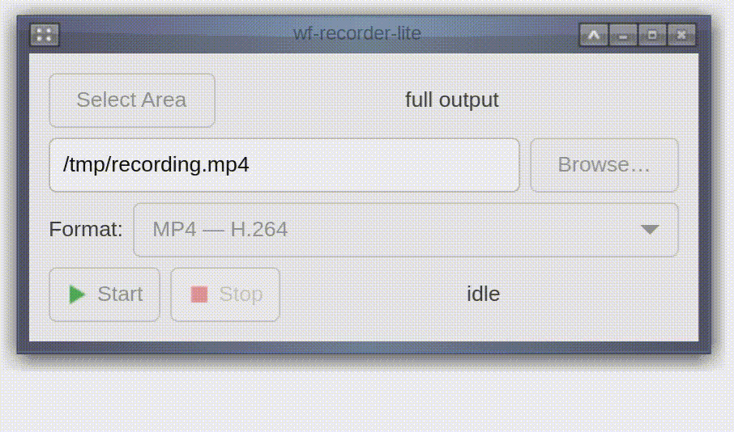

# wf-recorder-lite



Small gtkmm-4.0 control panel for [wf-recorder](https://github.com/ammen99/wf-recorder) on Wayland: select a
screen area, give it a file name, hit Start/Stop.

## Features

- **Select Area** — fullscreen transparent overlay; drag a rectangle
  (Esc cancels). The rectangle is converted to physical pixels for
  `wf-recorder -g` (correct under fractional scaling, e.g. scale 2.0).
- **Format** — choose the output:
  - *MP4 — H.264 (default)*: small, lossy.
  - *MP4 — lossless (pixel-perfect)*: `libx264 -p qp=0`, bit-exact — the
    best source for converting to a GIF. Larger files.
  - *GIF*: records losslessly (H.264 qp=0) to a temp `.mp4` and converts it
    to an animated GIF with ffmpeg on Stop (highest quality source; direct
    GIF output hits a [wf-recorder muxer bug](https://github.com/ammen99/wf-recorder/issues/356)). Wide sources are scaled down
    to ≤1280 px and the result is capped at 30 fps (recordings are captured
    at display refresh, e.g. 120 Hz — browsers enforce a minimum GIF frame
    delay, so uncapped GIFs play back at the wrong speed there). Note a GIF
    is always limited to 256 colours/frame, so it can't be fully
    pixel-perfect.
  - The file extension is kept in sync with the chosen format.
- **Save As… / Browse…** — standard file picker; the full path is always
  shown (in the field, and in a hover tooltip). Default location:
  `~/Videos` if it exists, else `~`.
- **Start** — spawns `wf-recorder` (with `-g <geom>` when an area is
  selected, otherwise the full output) writing to the given file.
- **Stop** — sends SIGINT (wf-recorder's clean-stop signal); the file
  is finalized.
- Live status: elapsed time + file size; "saved …" on finish.

## Runtime requirements

- Wayland compositor with `wlr-screencopy` support (wayfire ✓)
- `wf-recorder` in `PATH`
- `ffmpeg` in `PATH` (GIF mode only — the Stop-time conversion)
- `wl-clipboard` (`wl-copy`/`wl-paste`) so the clipboard survives closing
  the panel (optional, but recommended)
- GTK 4 runtime (built against gtkmm-4.0)

## Build

Two ways to build, pick by what's on the box:

| Target | Toolchain | Output | Requires on host |
| ------ | --------- | ------ | ---------------- |
| `make binary` | Docker (ephemeral) | `dist/wf-recorder-lite` | Docker |
| `make build-local` | Native | `build/wf-recorder-lite` | gtkmm-4.0, cmake, ninja |

### Docker — `make binary`

Requirements: **Docker only** — nothing else needs to be installed.
`make binary` builds the toolchain image ([Dockerfile](Dockerfile):
ubuntu 26.04, gtkmm 4.20.x) and compiles in an ephemeral container, then
copies the result to `dist/`.

```
make binary   # -> dist/wf-recorder-lite
make run      # run the dist binary
```

The binary runs against the box's GTK 4 runtime (GTK 4 minor versions
are ABI compatible).

### Native — `make build-local`

Requirements: **gtkmm-4.0** (`libgtkmm-4.0-dev`), **cmake** (≥ 3.16),
**ninja**.

```
make build-local   # -> build/wf-recorder-lite
```

### Tests

Unit tests for the pure path/format/wlr-randr logic run under CTest —
`ctest --test-dir build` after building (also runs in CI). The panel is
built for Wayland; the CI smoke test runs it under Xvfb (X11) as a
stand-in for the compositor.
